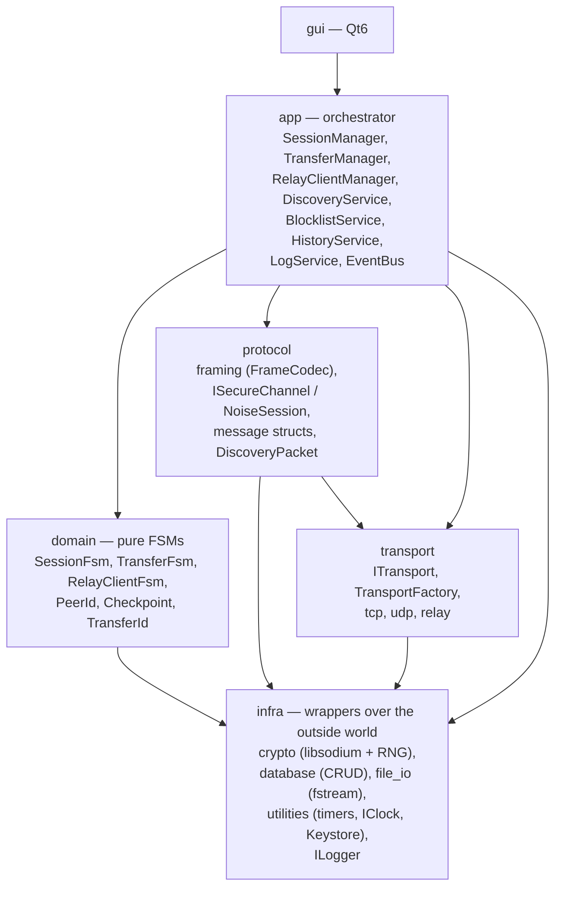
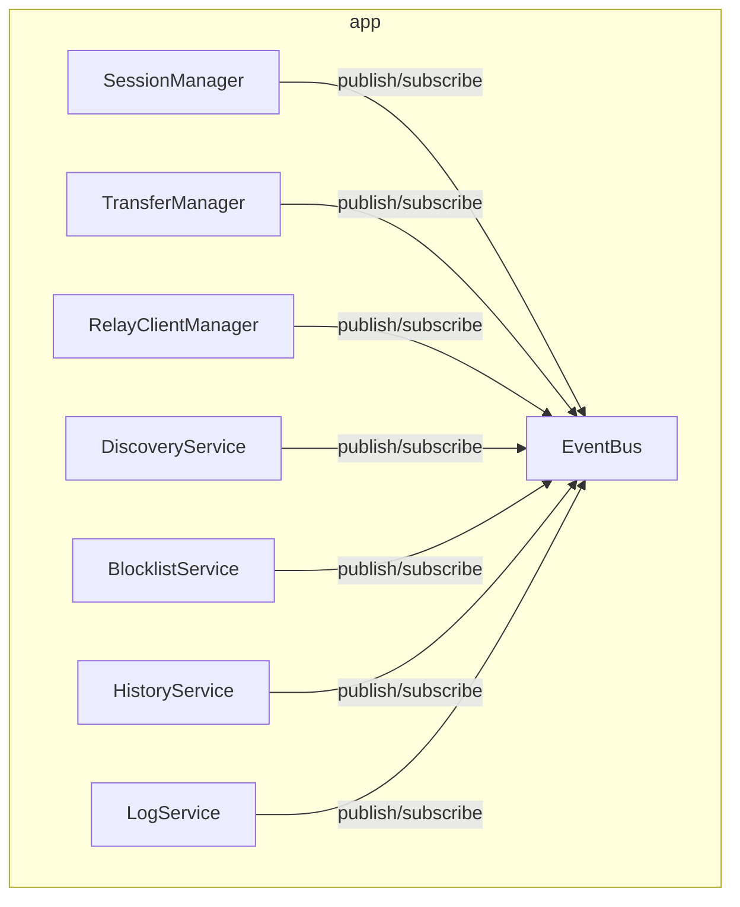

# Architecture

This document captures expensive decisions (layers, dependencies, execution model, module boundaries). Implementation details are intentionally omitted — they emerge from code and tests.

---

## Layers and Dependency Direction

`A --> B` means "A knows about B and may call B".



### Responsibilities

| Layer | Responsible for |
|---|---|
| `infra` | Wrappers over libsodium, SQLite, fstream, clock, RNG, keystore, ILogger. `ICrypto` (primitives), `IRandomSource` (RNG) are declared here (`infra/crypto`) | 
| `transport` | Byte stream to a peer: `ITransport`, `TcpTransport`, `UdpTransport`, `RelayTransport`, `TransportFactory` | 
| `protocol` | Frames (`FrameCodec`), message structs, `ISecureChannel` / `NoiseSession` (decorator over `ITransport`), `DiscoveryPacket` (struct + `verify()`) | 
| `domain` | Pure FSMs (`handle(Event) -> (State, vector<Effect>)`), `PeerId`, `Checkpoint`, `TransferId`, transition rules |
| `app` | Orchestration: executes FSM effects, wires FSMs together, publishes events to `EventBus` | 
| `gui` | Widgets, presentation |

### Key Consequences

- **`security` is not a layer.** `NoiseSession` is an `ISecureChannel` implementing `ITransport` as a decorator. TLS is a detail of `RelayTransport`. `RelayClientFsm` lives in `domain`, `RelayClientManager` in `app`. Encryption is orthogonal to transport: `make_unique<NoiseSession>(make_unique<AnyTransport>(...))` works for any `ITransport`.
- **`logging` is not a layer.** `ILogger` lives in `infra`, `LogService` (database writes, filtering) in `app`. It is a cross-cutting concern, not a layer.
- **`session` and `transfer` are not layers.** Both are modules of `domain`, sitting side by side and unaware of each other. `app` wires them together.
- **`discovery` is not a layer.** UDP lives in `transport`, packet validation in `protocol` (`DiscoveryPacket`), `DiscoveryService` (broadcast + receive + rate-limit + event publication) in `app`.

### Extensibility Test

| Change | Must touch | 
|---|---|
| New transport (e.g. `laser`, future) | `transport/<name>` + `TransportFactory` |
| New protocol message | `protocol` + `domain` (handler) + `app` (translation) | 
| New GUI panel | `gui` | 
| Database swap | `infra/database` + repositories | 
| Crypto library swap | `infra/crypto` | 

The `laser` transport is **not part of v1** and is deliberately absent from the diagram. It remains in this table as a check: if adding laser requires changes above `transport`, the architecture is broken.

---

## Execution Model

**Single network event loop** (asio or the Qt event loop) owns all `ITransport`, `ISecureChannel`, and FSMs. All FSMs and transports run on this thread; there are no blocking `read()` calls.

**GUI runs on its own thread** (the Qt main thread). GUI ↔ `app` communication goes through a signal queue (`EventBus` → Qt signals). The GUI never calls `app` synchronously from the network thread.

**SQLite runs on the network thread in WAL mode.** This is sufficient for v1; if needed, it moves to a dedicated writer thread with a queue.

---

## FSMs Are Pure Functions

All three state machines (`SessionFsm`, `TransferFsm`, `RelayClientFsm`) are **pure functions**:

```cpp
std::pair<State, std::vector<Effect>> handle(State s, Event e);
```

- No I/O, no database, no sockets, no timers inside an FSM.
- An FSM returns **effects** (`SendFrame{...}`, `WriteCheckpoint{...}`, `NotifyUser{...}`), which `app` executes.
- Tested in millions of cases per second without network or disk.
- Transition tables from `protocol.md` and `session.md` map 1-to-1 to a `switch` or table.
---

## Orchestrator (`app`): Managers, Not a God Object

`app` is a **layer, not a class**. It contains managers with narrow responsibilities, wired through `EventBus`. Managers **do not know about each other** directly.



### Manager Responsibilities

| Manager | Owns | Executes effects |
|---|---|---|
| `SessionManager` | `SessionFsm`, `ISecureChannel` | Sends/receives session frames, closes the transport, publishes `SessionEstablished` / `SessionClosed` |
| `TransferManager` | `map<TransferId, TransferFsm>`, `ITransferRepository`, `IFileSystem` | Writes checkpoints, reads/writes files, sends `CHUNK`/`CHUNK_ACK`, publishes `TransferProgress` |
| `RelayClientManager` | `RelayClientFsm` | TLS handshake, `REGISTER`, `RELAY_PING`/`PONG`, `RENDEZVOUS_REQUEST`; on `PIPE_OPEN` publishes `RelayPipeOpened{ITransport}` — `SessionManager` is subscribed and takes the transport |
| `DiscoveryService` | `IUdpTransport` | Broadcast, receive, structural validation, calls `protocol::DiscoveryPacket::verify()`, rate-limits per source IP, publishes `PeerDiscovered` |
| `BlocklistService` | `IBlocklistRepository` | Checks `PeerId` at every layer, publishes `PeerBlocked` |
| `HistoryService` | `IHistoryRepository` | Writes/reads transfer history |
| `LogService` | `ILogger`, `ILogRepository` | Writes logs to the database, filters/sorts for the GUI |

#### Transfer queue 
The per-direction queue is an ordered list of TransferIds whose TransferFsm is in IDLE (max 1 active per direction). It is owned by TransferManager as plain data (std::deque<TransferId>). Queue operations — enqueue, dequeue, priority up/down — are reordering and push/pop on this list, with no transition logic of their own; they only trigger scheduleNext(dir) and publish QueueUpdated for the GUI. A separate queue manager is not introduced.

### Data Flow (example: incoming `CHUNK`)

```
TcpTransport::read()                → vector<uint8_t>
NoiseSession::open()                → decrypted frame
FrameCodec::decode()                → protocol::Chunk
SessionManager::onFrame()           → domain::ChunkReceived{transferId, data}
  → publish to EventBus
TransferManager::onEvent()          → finds TransferFsm, calls handle()
TransferFsm::handle()               → (newState, [WriteDisk, SendAck, UpdateCheckpoint])
TransferManager::executeEffects()   → fs.write, channels.send(ack), repo.save
  → publish TransferProgress
GUI (subscribed)                    → updates progress bar
```
---

## Interfaces Between Layers

An interface is introduced only when there is a substitution scenario: a test that cannot use the real resource (time, randomness, disk, network, database), or a second implementation (OS-specific keystore, alternative transport, alternative crypto library). Interfaces are not created "just in case". Concrete value types (`PeerId`, `Checkpoint`, `TransferId`, `FrameCodec`, `DiscoveryPacket`) are not interfaces — they have no substitution scenario.

### Boundary-critical interfaces

Removing any of these breaks layer isolation:

- **transport**: `ITransport` (byte stream), `TransportFactory` (creation by kind). `IUdpTransport` is a transport-specific extension for discovery.
- **protocol**: `ISecureChannel` (seal/open; `NoiseSession` is the implementation). `FrameCodec` is a concrete class, not an interface — it is a pure function with no substitution scenario.
- **infra**: ICrypto` (primitives: hash, signatures, AEAD), `IRandomSource` (RNG; `SodiumRandom` for production, `FakeRandom` for tests), `IDatabase` + repository interfaces (`ITransferRepository`, `IPeerRepository`, `IBlocklistRepository`, `IHistoryRepository`, `ILogRepository`), `IFileSystem`, `IClock`, `IKeystore`, `ILogger`.
- **app**: `EventBus` (mediator between managers).

### Adding a new interface

An interface is justified when at least one of the following holds:

1. There is a test that would otherwise require a real resource (clock, RNG, disk, socket, database) → interface.
2. There is a second implementation (different OS, transport, crypto library, database backend) → interface.
3. Neither → concrete class.

### Signatures

Signatures are written before a module is implemented and emerge from the first consumer test. They are not listed here because they change with the code; this section locks down **which boundaries must be interfaces**, not their exact shape.

---

## Out of Scope for This Document

- Class diagrams with fields and methods — code is the source of truth.
- Private methods, helpers, factories — emerge as needed.
- Full database schema — fixed in `storage.md`.
- Exact message structs — fixed in `protocol.md`.
